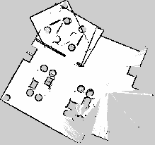

# 🤖 Office Mapping & Patrol Robot

**ROS 2 Jazzy · SLAM Toolbox · Nav2 · Gazebo Harmonic · Python**

A simulated **TurtleBot3 Burger** is dropped into an **unknown 12 m × 8 m office** and, using only
its **360° LIDAR**, maps every room on its own, saves the map, then localises on it and runs an
autonomous **security-style patrol** between the rooms.


*The robot explores the office by itself: SLAM Toolbox builds the map from LIDAR scans while a custom
frontier-exploration node keeps sending Nav2 to the edge of the unexplored area.*

---

## ✨ Highlights

- **Fully autonomous mapping.** A custom **frontier-exploration node** finds the boundary between
  mapped and unmapped space, picks the best target, and drives there with Nav2 until nothing is left
  to explore. It then saves the map and returns home.
- **LIDAR-only SLAM.** SLAM Toolbox (online async, loop closure) tuned for the LDS-01 LIDAR:
  360 beams, 5 Hz, 0.12–3.5 m range.
- **Nav2 patrol.** AMCL localisation on the saved map plus a waypoint patrol through 5 rooms, with
  timeout/skip recovery and a CSV report of every visit.
- **Custom office world.** Generated from a parametric Python script: open-plan desks, meeting room,
  manager's office, storage area and kitchen, with 1 m doorways.
- **Tested.** Unit tests for the frontier logic and a ROS-free exploration simulator that measures
  map coverage.

## 🗺️ The office and the map it built

| Office floor plan (ground truth) | Map built by the robot (SLAM Toolbox) |
|---|---|
|  |  |

*Left: dark shapes are what the robot and its LIDAR (scan plane ≈ 0.17 m) interact with; light
shapes sit above the scan plane. Desk tops are invisible to a 2D LIDAR, which only sees the legs and
drawer units. Orange dots are the patrol waypoints.*

---

## ⚙️ How it works

| Stage | What happens | Nodes |
|---|---|---|
| **1. Sense** | Burger's LIDAR publishes `/scan`, bridged from Gazebo with `/odom`, `/tf`, `/clock` | `ros_gz_bridge` |
| **2. Map** | Graph SLAM with loop closure builds `/map` and the `map → odom` transform | `slam_toolbox` |
| **3. Explore** | Find frontiers → cluster → score → send to Nav2 → repeat → save map → go home | **`frontier_explorer`** *(custom)* |
| **4. Localise** | Particle filter localisation on the saved map | `amcl`, `map_server` |
| **5. Patrol** | Visit named rooms in a loop, skip unreachable ones, log results | **`waypoint_patrol`** *(custom)* |

```
 Gazebo: office world + TurtleBot3 Burger
     │  /scan  /odom  /tf  /clock                          ▲ /cmd_vel
     ▼                                                     │
 slam_toolbox ──/map──► frontier_explorer ──NavigateToPose──► Nav2
                                                           (planner · controller · costmaps)
 saved map ──► map_server + AMCL ──► waypoint_patrol ──────►┘
```

---

## 📊 Results

### Gazebo run

| Metric | Value |
|---|---|
| Time to map the whole office autonomously | **_X.X min_** |
| Free floor area mapped | **_XX.X m²_** |
| Exploration goals reached / failed | **_X / X_** |
| Patrol waypoints reached | **_X / X (XX %)_** |

<sub>Fill these in from the explorer's final log line (`No frontiers left: office mapped in ...`) and
the patrol's (`Patrol done: X/Y waypoints reached ...`). The full patrol log is in
`~/office_nav_maps/patrol_report.csv`.</sub>

### Offline coverage check

`tools/offline_exploration_sim.py` runs the **same frontier code** against a ray-cast LIDAR in the
office floor plan, with no ROS needed. It uses SLAM Toolbox's rule that a cell only counts as free
once two beams have crossed it.

| Metric | Value |
|---|---|
| Reachable floor mapped | **99.2 %** (59.7 of 60.2 m²) |
| Frontier goals | 12 (4 unreachable ones blacklisted automatically) |
| Distance driven | ≈ 38 m |

<details>
<summary>Offline exploration path</summary>


</details>

---

## 🚀 Quick start

Tested on **Ubuntu 24.04 · ROS 2 Jazzy · Gazebo Harmonic**.

### 1. Install

```bash
sudo apt install ros-jazzy-navigation2 ros-jazzy-nav2-bringup ros-jazzy-slam-toolbox \
                 ros-jazzy-ros-gz 'ros-jazzy-turtlebot3*' python3-numpy python3-yaml

mkdir -p ~/office_nav_ws/src && cd ~/office_nav_ws/src
git clone https://github.com/harishvenky29/ros2-office-slam-nav2.git office_nav
# TurtleBot3 Gazebo models and launch files (skip if already installed)
git clone -b jazzy https://github.com/ROBOTIS-GIT/turtlebot3_simulations.git

cd ~/office_nav_ws
rosdep install --from-paths src --ignore-src -y
colcon build --symlink-install
source install/setup.bash
export TURTLEBOT3_MODEL=burger
```

### 2. Map the office autonomously

```bash
ros2 launch office_nav mapping.launch.py explore:=true
```

Gazebo and RViz open, and after about 15 s the robot starts exploring by itself. To see the targets
it picks, add a **MarkerArray** display on `/explore/frontiers` in RViz (orange spheres). When it's
done, the map is saved to `~/office_nav_maps/office_map.{yaml,pgm}` and the robot drives back to the
start.

<details>
<summary>Prefer to drive it yourself?</summary>

```bash
ros2 launch office_nav mapping.launch.py
ros2 run turtlebot3_teleop teleop_keyboard                                # 2nd terminal
mkdir -p ~/office_nav_maps
ros2 run nav2_map_server map_saver_cli -f ~/office_nav_maps/office_map    # when finished
```
</details>

### 3. Navigate and patrol

```bash
ros2 launch office_nav navigation.launch.py                         # click "Nav2 Goal" in RViz
ros2 launch office_nav navigation.launch.py patrol:=true loops:=3   # autonomous patrol (0 = forever)
```

The patrol sets AMCL's starting pose itself, then visits
`storage_area → manager_office → kitchen → open_plan → meeting_room → home`. It pauses 2 s at each
room, skips any room it can't reach within 90 s, and writes a CSV report. Change the route in
[`config/office_waypoints.yaml`](config/office_waypoints.yaml).

---

## 🧠 Design decisions

- **Map frame = world frame.** The robot spawns at (0, 0, yaw 0) and SLAM starts the map at the
  robot, so waypoints can be read straight off the Gazebo floor plan.
- **Frontier explorer.**
  - On start-up it spins 360° (Nav2 `spin` behaviour) so SLAM gets a full first view.
  - It never declares the map finished in the first 30 s. If no frontier is reachable, it spins
    again and waits for the map to update.
  - Detection lives in `office_nav/frontiers.py`: pure numpy, no ROS imports, unit-tested. It
    finds the free/unknown boundary and drops frontier cells within 15 cm of an obstacle, because
    Nav2 can't reach them.
  - Frontiers are grouped with 8-connected clustering, and frontiers longer than 2 m are split up.
    A ring-shaped frontier around the robot at start-up would otherwise have its centre on the robot.
  - The goal is the frontier cell nearest the cluster centre, because a centre can fall in unknown
    space.
  - Goals are scored `distance − 0.5 × frontier length`, so big, nearby openings win.
  - Failed or timed-out goals are blacklisted. If a goal's frontier gets mapped on the way, it is
    dropped early.
- **Costmap tuning.** TurtleBot3's default 0.5 m inflation makes 1 m doorways look almost blocked.
  It is 0.35 m here (cost scaling 4.0), so the planner goes through doors cleanly.
- **SLAM tuning.**
  - Laser range is clamped to the LDS-01's 0.12–3.5 m.
  - The map updates every 2 s (default 5 s) so the explorer reacts faster.
  - Scan-matching thresholds are lowered to 0.3 m / 0.3 rad for small rooms.
- **Realistic 2D-LIDAR blind spots.** Desks and tables are modelled with legs and panels rather
  than solid boxes, so the robot has to deal with sparse obstacles like a real office.

---

## 📁 Repository layout

```
office_nav/
├── launch/
│   ├── office_world.launch.py      # Gazebo + office world + Burger + ROS-Gazebo bridge
│   ├── mapping.launch.py           # + SLAM Toolbox + RViz  (+ Nav2 + explorer: explore:=true)
│   └── navigation.launch.py        # + Nav2/AMCL on the saved map  (+ patrol: patrol:=true)
├── office_nav/
│   ├── frontiers.py                # frontier detection / clustering / selection (pure numpy)
│   ├── frontier_explorer.py        # autonomous mapping node
│   └── waypoint_patrol.py          # Nav2 Simple Commander patrol + CSV report
├── config/
│   ├── slam_toolbox_office.yaml
│   ├── nav2_params.yaml            # based on turtlebot3_navigation2 (Apache-2.0), tuned for doorways
│   └── office_waypoints.yaml
├── worlds/small_office.sdf         # generated: edit tools/generate_office_world.py instead
├── tools/
│   ├── generate_office_world.py    # parametric office layout → SDF
│   ├── render_layout.py            # floor-plan image + waypoint clearance check
│   └── offline_exploration_sim.py  # ROS-free exploration coverage test
├── docs/                           # demo GIF, maps and figures
└── test/test_frontiers.py          # pytest
```

Run the tests with `python3 -m pytest test` or `colcon test --packages-select office_nav`.

---

## 🛠️ Troubleshooting

| Symptom | Fix |
|---|---|
| `KeyError: 'TURTLEBOT3_MODEL'` | `export TURTLEBOT3_MODEL=burger` |
| `Package 'office_nav' not found` | Run `colcon build`, then `source install/setup.bash` in every new terminal |
| Robot ignores teleop | Jazzy uses `TwistStamped` on `/cmd_vel`; use the Jazzy `turtlebot3_teleop` |
| Nav2 reports no map | Check `~/office_nav_maps/office_map.yaml` exists, or pass `map:=/path/to/map.yaml` |
| Robot localises in the wrong place | Use **2D Pose Estimate** in RViz at the origin, facing +x |
| Explorer waits forever | Nav2 didn't start; look for lifecycle errors from `navigation_launch` |

---

## 👤 Author

**Harish Venkatesan M R** · MSc Intelligent Robotics, University of York

[GitHub](https://github.com/harishvenky29) · [LinkedIn](https://linkedin.com/in/harish-venkatesan-m-r-833173191)

<sub>Licensed under Apache-2.0. `config/nav2_params.yaml` is adapted from ROBOTIS'
`turtlebot3_navigation2` (Apache-2.0).</sub>
