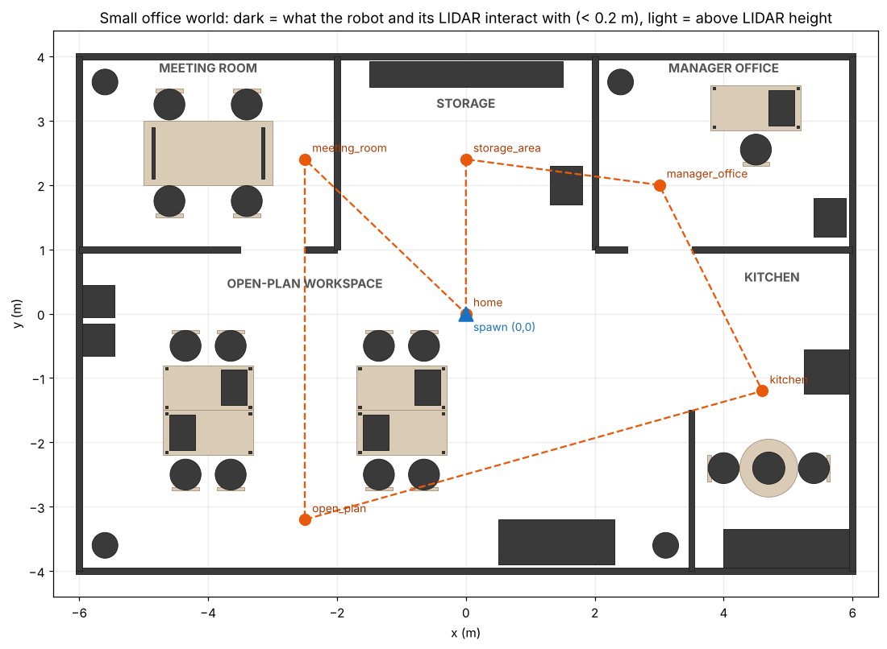
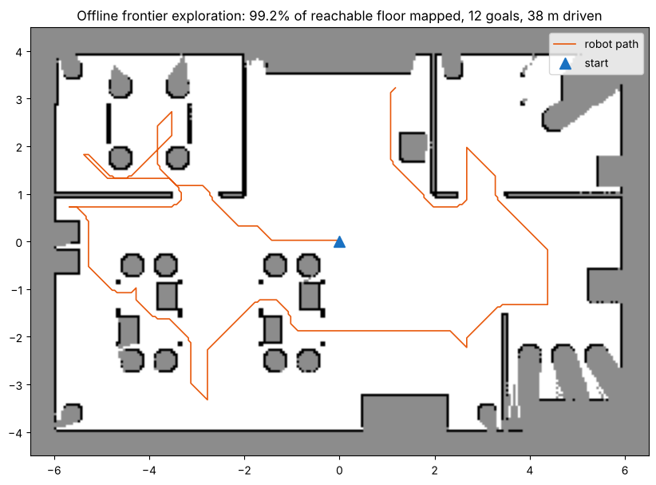

# Office Mapping & Patrol Robot — ROS 2 Jazzy · SLAM Toolbox · Nav2 · Gazebo

A simulated **TurtleBot3 Burger** is dropped into an unknown **12 m × 8 m office** (open-plan
desks, meeting room, manager's office, storage area, kitchen). Using only its **360° LIDAR**, it
maps the whole office with **SLAM Toolbox** — either driven by hand or **fully autonomously with a
custom frontier-exploration node** — then localises on the saved map with **AMCL** and runs a
**Nav2 waypoint patrol** around the rooms, logging a CSV report.

`ROS 2 Jazzy` `SLAM Toolbox` `Nav2` `Gazebo Harmonic` `Python` `LIDAR`



*Dark shapes are what the LIDAR (scan plane ≈ 0.17 m) and the robot interact with; light shapes
sit above the scan plane — desk tops, for example, are invisible to a 2D LIDAR, which only sees the
legs and drawer pedestals.*

---

## What it does

| Stage | How | Nodes |
|---|---|---|
| **1. Sense** | LDS-01 LIDAR: 360 beams, 5 Hz, 0.12–3.5 m, bridged from Gazebo on `/scan` | `ros_gz_bridge` |
| **2. Map** | Online async graph SLAM with loop closure → `/map` + `map → odom` TF | `slam_toolbox` |
| **3. Explore** *(optional)* | Finds frontiers (free cells bordering unknown), clusters them, sends the best one to Nav2, repeats until none are left, then saves the map and drives home | **`frontier_explorer`** (custom) |
| **4. Localise** | Particle filter on the saved map | `amcl`, `map_server` |
| **5. Patrol** | Visits named rooms in a loop, with timeout/skip handling and a CSV report | **`waypoint_patrol`** (custom) |

```
 Gazebo (office world + Burger)
   │ /scan /odom /tf /clock           ▲ /cmd_vel
   ▼                                  │
 slam_toolbox ──/map──► frontier_explorer ──NavigateToPose──► Nav2 (planner, controller, costmaps)
                        (or AMCL + saved map ──► waypoint_patrol ──► Nav2)
```

## Results

Offline check (`tools/offline_exploration_sim.py`, runs the same frontier code against a ray-cast
LIDAR in the office floor plan, with SLAM Toolbox's rule that a cell is only free once two beams have crossed it. No ROS needed):

| Metric | Value |
|---|---|
| Reachable floor mapped | **99.2 %** (59.7 of 60.2 m²) |
| Frontier goals | 12 (4 unreachable ones blacklisted automatically) |
| Distance driven | ≈ 38 m |



> Add your own Gazebo numbers here after a run: the explorer prints mapping time, mapped area and
> goals reached when it finishes, and the patrol writes `~/office_nav_maps/patrol_report.csv`.

---

## Setup

Tested target: **Ubuntu 24.04, ROS 2 Jazzy, Gazebo Harmonic**.

```bash
sudo apt install ros-jazzy-navigation2 ros-jazzy-nav2-bringup ros-jazzy-slam-toolbox \
                 ros-jazzy-ros-gz 'ros-jazzy-turtlebot3*' python3-numpy python3-yaml

mkdir -p ~/Projects/office_nav_ws/src && cd ~/Projects/office_nav_ws/src
git clone <this repo> office_nav
# TurtleBot3 Gazebo models/launch files (skip if you already have them)
git clone -b jazzy https://github.com/ROBOTIS-GIT/turtlebot3_simulations.git

cd ~/Projects/office_nav_ws
rosdep install --from-paths src --ignore-src -y
colcon build --symlink-install
source install/setup.bash
echo 'export TURTLEBOT3_MODEL=burger' >> ~/.bashrc   # launch files default to burger anyway
```

## Run it

### Option A — autonomous mapping (recommended for the demo)

```bash
ros2 launch office_nav mapping.launch.py explore:=true
```

Gazebo and RViz open, the robot spins up its LIDAR, and after ~15 s the explorer starts driving to
frontiers (orange spheres — add a **MarkerArray** display on `/explore/frontiers` in RViz). When the
office is fully mapped it saves the map to `~/office_nav_maps/office_map.{yaml,pgm}` and returns to
the start.

### Option B — manual mapping

```bash
ros2 launch office_nav mapping.launch.py
ros2 run turtlebot3_teleop teleop_keyboard            # 2nd terminal: drive through every room
mkdir -p ~/office_nav_maps
ros2 run nav2_map_server map_saver_cli -f ~/office_nav_maps/office_map   # 3rd terminal, when done
```

### Navigate and patrol on the saved map

```bash
ros2 launch office_nav navigation.launch.py                         # click "Nav2 Goal" in RViz
ros2 launch office_nav navigation.launch.py patrol:=true loops:=3   # automatic patrol (0 = forever)
```

The patrol sets AMCL's initial pose itself (the robot starts at the origin), visits
`storage_area → manager_office → kitchen → open_plan → meeting_room → home`, waits 2 s at each, skips
any waypoint that takes longer than 90 s, and writes a per-waypoint CSV report.

Change the route in [`config/office_waypoints.yaml`](config/office_waypoints.yaml) — no rebuild needed
with `--symlink-install`.

---

## Design notes

- **Map frame = world frame.** The robot spawns at (0, 0, yaw 0) and SLAM starts the map at the
  robot, so waypoint coordinates can be read straight off the Gazebo floor plan.
- **Frontier explorer.** On start-up it spins 360° (Nav2 `spin` behaviour) so SLAM gets a full first view, and it never declares the map finished in the first 30 s; if nothing is reachable it spins again and waits for the map to update. Pure-numpy detection in `office_nav/frontiers.py` (unit-tested, no ROS
  imports): 4-neighbour free/unknown boundary, frontier cells within 15 cm of an obstacle dropped
  (Nav2 can't reach them), 8-connected clustering, frontiers longer than 2 m split into pieces (a frontier ringing the robot at start-up would otherwise have its centroid on the robot itself), goal = the frontier cell nearest the cluster
  centroid (a centroid can fall in unknown space). Goals are scored `distance − 0.5 × frontier length`,
  so the robot favours big, nearby openings. Failed/timed-out goals are blacklisted; a goal whose
  frontier gets mapped on the way is pre-empted so the robot doesn't drive somewhere already seen.
- **Costmap tuning.** TurtleBot3's default `inflation_radius` of 0.5 m makes 1 m office doorways look
  almost blocked; it is 0.35 m here (cost scaling 4.0), so the planner goes through doors cleanly.
- **SLAM tuning.** Laser range clamped to the LDS-01's 0.12–3.5 m; map updates every 2 s instead of 5 s
  so the explorer reacts faster; travel thresholds lowered to 0.3 m / 0.3 rad for small rooms.
- **2D LIDAR blind spots are part of the world.** Desks and the meeting table are built with legs /
  panels so the scan sees realistic sparse obstacles, not solid boxes.

## Repository layout

```
office_nav/
├── launch/
│   ├── office_world.launch.py     # Gazebo + office world + Burger + ROS-Gazebo bridge
│   ├── mapping.launch.py          # + SLAM Toolbox + RViz (+ Nav2 + explorer with explore:=true)
│   └── navigation.launch.py       # + Nav2/AMCL on the saved map (+ patrol with patrol:=true)
├── office_nav/
│   ├── frontiers.py               # frontier detection / clustering / selection (pure numpy)
│   ├── frontier_explorer.py       # autonomous mapping node
│   └── waypoint_patrol.py         # Nav2 Simple Commander patrol + CSV report
├── config/
│   ├── slam_toolbox_office.yaml
│   ├── nav2_params.yaml           # from turtlebot3_navigation2 (Apache-2.0), tuned for doorways
│   └── office_waypoints.yaml
├── worlds/small_office.sdf        # generated -- edit tools/generate_office_world.py instead
├── tools/
│   ├── generate_office_world.py   # parametric office layout -> SDF
│   ├── render_layout.py           # floor-plan PNG + waypoint clearance check
│   └── offline_exploration_sim.py # ROS-free exploration coverage test
└── test/test_frontiers.py         # pytest
```

Tests: `python3 -m pytest test` (or `colcon test --packages-select office_nav`).

## Troubleshooting

| Symptom | Fix |
|---|---|
| `KeyError: 'TURTLEBOT3_MODEL'` from a TurtleBot3 launch file | `export TURTLEBOT3_MODEL=burger` |
| Robot doesn't move with teleop | Jazzy uses `TwistStamped` on `/cmd_vel`; use the Jazzy `turtlebot3_teleop` |
| Nav2 says "no map" in navigation mode | Check `~/office_nav_maps/office_map.yaml` exists or pass `map:=...` |
| Robot localises wrongly on start | Use **2D Pose Estimate** in RViz at the origin, facing +x |
| Explorer waits forever | Nav2 hasn't started; check the `navigation_launch` output for lifecycle errors |

## Built by

Harish Venkatesan M R — MSc Intelligent Robotics, University of York ·
[GitHub](https://github.com/harishvenky29) · [LinkedIn](https://linkedin.com/in/harish-venkatesan-m-r-833173191)
